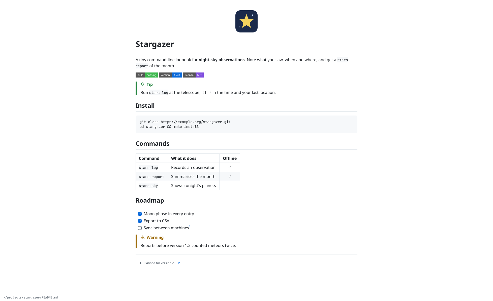
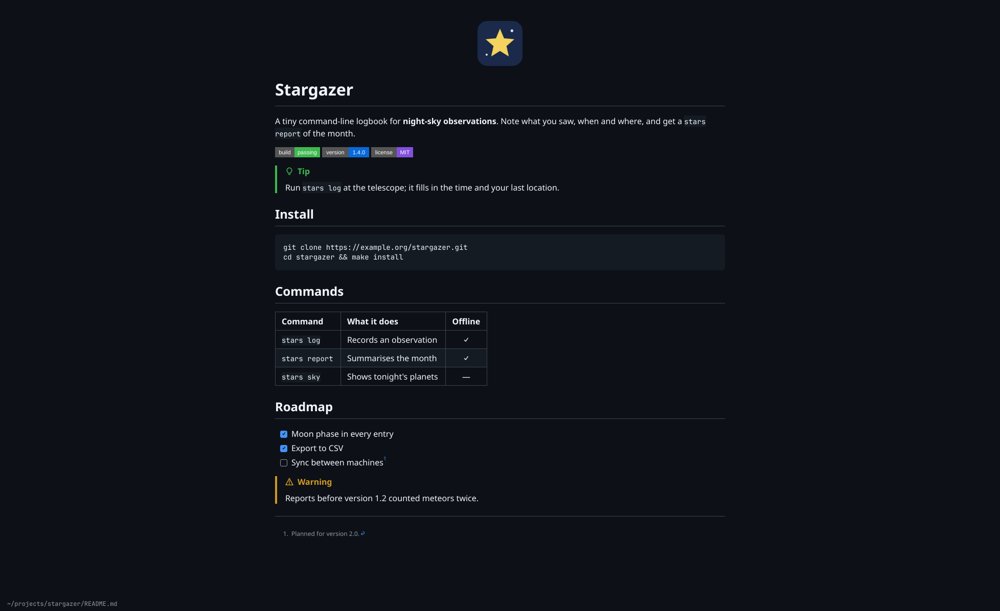

# Omaread

A dead-simple Markdown reader built with Qt Quick and C++. It shows a file the
way GitHub shows it, follows the Omarchy theme and system dark/light mode, and
keeps up with the file as it changes. It is modelled on
[Omawrite](https://github.com/omacom/omawrite), and the two work as a pair:
write in one, read in the other.




Files are parsed by [cmark-gfm](https://github.com/github/cmark-gfm), the
parser github.com itself uses, with the same extensions. That covers tables,
task lists, strikethrough, autolinks and footnotes, plus GitHub's alerts
(`> [!NOTE]`, `> [!TIP]`, `> [!IMPORTANT]`, `> [!WARNING]`, `> [!CAUTION]`),
and GitHub's emoji shortcodes, so `:tada:` shows 🎉.
Headings, quotes, code panels and tables use github.com's sizes and spacing.
Colours come from the current Omarchy theme, and fall back to GitHub's own
light and dark palettes when there is none.

READMEs read as they would in their repository:

- Images and links resolve relative to the file. A path starting with `/`
  resolves from the root of the git repository the file is in.
- Badges and screenshots load from the web, and GIFs play.
- HTML such as `<p align="center"></p>`, `<div align="center">`
  and `<details>` is honoured, and scripts and styles are dropped. `<details>`
  folds as on GitHub: closed unless it says `open`, and a click on its summary
  opens or closes it. A link to a heading inside opens it, and it prints open.
- A link to another Markdown file opens it in the same window. `Alt+Left` comes
  back to where you were. Links to `#headings` and footnotes scroll there, and
  web links open in the browser.

## Command line

`omaread FILE` opens a Markdown file. `omaread` alone opens an empty window to
drop a file on. `omaread --help` and `omaread --version` answer in the terminal
without opening a window.

## Shortcuts

- `Ctrl+O` opens a Markdown file through the portal picker. Dropping a file on
  the window works too.
- `Ctrl+P` prints, or saves a PDF through the print dialog. The page is laid
  out as on screen, in GitHub's light colours whatever the screen shows.
- `Ctrl+E` opens the file in Omawrite, when it is installed. Omaread keeps
  showing the file and updates as you save.
- `Ctrl+R` or `F5` reloads, though changes on disk are picked up by themselves.
- `Alt+Left` or `Backspace` goes back after following a link.
- `Ctrl+=` and `Ctrl+-` change the text size, `Ctrl+0` returns to the default.
  `Ctrl+scroll` does the same.
- `Ctrl+C` copies the selected text. Code blocks have a Copy button.
- `Up`/`Down` or `j`/`k` scroll, as do `Page Up`/`Page Down` and `Space`.
  `Home`/`End` or `g`/`G` jump to the top and bottom.
- `Super+F` or `F11` toggles fullscreen.
- `Ctrl+W` or `Ctrl+Q` closes the window.

Text follows the desktop text size (`omarchy display text size`, or GNOME's
`text-scaling-factor`), and `Ctrl+=` / `Ctrl+-` set your own size on top of it.
That size is remembered.

## Requirements

- Qt 6: `qt6-base` (which includes printing), `qt6-declarative` (which includes Qt Quick Controls) and
  `qt6-svg` for SVG images and badges
- `cmark-gfm`
- `xdg-desktop-portal` and a portal backend

## Build and install

Install the requirements above, a C++17 compiler such as `gcc`, and `make`:

```sh
./bin/build
./bin/test
./build/omaread README.md
```

`bin/test` runs the Qt test suite with the offscreen platform, so it does not
need a graphical session.

On Arch Linux or Omarchy, install `base-devel` for the packaging tools, then
build and install the package:

```sh
./bin/install
```

This runs the local build and `makepkg -fsi`, which installs the package through
pacman and may ask for authentication. To make Omaread what opens `.md` files:

```sh
xdg-mime default omaread.desktop text/markdown text/x-markdown
```

## Seeing changes without a window

`bin/snapshot` renders a file offscreen, to look at a change without opening
Omaread: a PNG of the window, or the printed pages as a PDF.

```sh
./bin/snapshot README.md /tmp/readme.png                 # in your Omarchy theme
./bin/snapshot --light --size 800x1200 README.md /tmp/readme.png
./bin/snapshot --dark --scroll 900 README.md /tmp/further-down.png
./bin/snapshot README.md /tmp/readme.pdf                 # as printed, on A4
```

QML warnings show in the terminal. `--light` and `--dark` use GitHub's own
colours instead of the Omarchy theme.

`bin/screenshots` remakes the two screenshots above from a made-up project in
`tools/demo/stargazer`. `tools/update-emoji` remakes the emoji shortcodes from
GitHub's list in [gemoji](https://github.com/github/gemoji).

## Not yet

Syntax highlighting in code blocks, find in page, Mermaid diagrams and math.

## License

MIT. Parts are adapted from Omawrite, also MIT; see `LICENSE`.