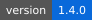

<p align="center">
  
</p>

# Stargazer

A tiny command-line logbook for **night-sky observations**. Note what you saw, when and where, and get a `stars report` of the month.

  

> [!TIP]
> Run `stars log` at the telescope; it fills in the time and your last location.

## Install

```sh
git clone https://example.org/stargazer.git
cd stargazer && make install
```

## Commands

| Command | What it does | Offline |
| :--- | :--- | :---: |
| `stars log` | Records an observation | ✓ |
| `stars report` | Summarises the month | ✓ |
| `stars sky` | Shows tonight's planets | — |

## Roadmap

- [x] Moon phase in every entry
- [x] Export to CSV
- [ ] Sync between machines[^1]

> [!WARNING]
> Reports before version 1.2 counted meteors twice.

[^1]: Planned for version 2.0.
